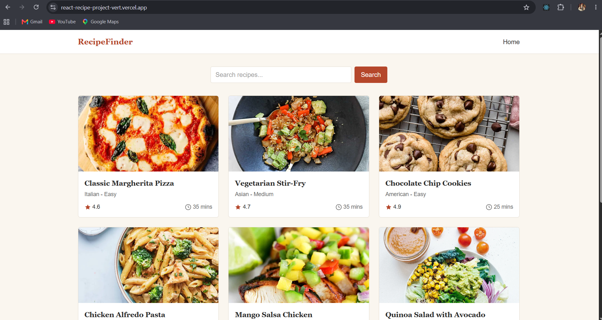

# 🍳 Recipe Finder

A responsive Recipe Finder web application built with **React JS**. Search for recipes, explore recipe cards, and view ingredients and cooking instructions. This project was built during my React learning journey and deployed using Vercel.

## 📸 Preview



🔗 **[Live Demo](https://react-recipe-project-vert.vercel.app/)**

## ✨ Features

- 🔍 Search for recipes
- 🍽️ Browse recipe cards with images
- 📝 View ingredients and cooking instructions
- 🌐 Fetch recipe data from an API
- 📄 Navigate through results with pagination
- 🔄 Client-side routing without full-page reloads
- 🛠️ Handle failed API requests with error handling
- 📱 Responsive layout for mobile and desktop screens

## 🛠️ Tech Stack

- **React JS** — UI development
- **Tailwind CSS** — Styling
- **Vite** — Development server and build tool
- **React Router** — Client-side navigation
- **Axios** — API requests
- **Recipe API** — Recipe data

## 🚀 Getting Started

To run the project locally, make sure you have [Node.js](https://nodejs.org/) and npm installed.

1. **Clone the repository**

   ```bash
   git clone https://github.com/sahil-verma77/React-Recipe-Project.git
   ```

2. **Open the project folder**

   ```bash
   cd React-Recipe-Project
   ```

3. **Install dependencies**

   ```bash
   npm install
   ```

4. **Start the development server**

   ```bash
   npm run dev
   ```

   Open the local URL shown in your terminal.

## 📦 Build for Production

```bash
npm run build
```

## 📚 What I Practiced

Building this project helped me practice React development, API integration, client-side routing, pagination, error handling, and deploying a project with Vercel.

---

Made while learning React JS 💻
